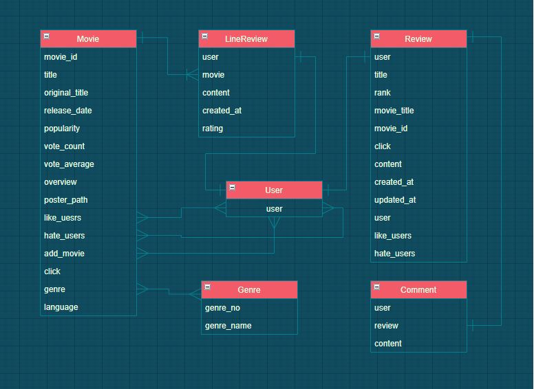

# 🎬 MovieStar — 영화 추천 커뮤니티

**좋아요 기반 영화 추천과 영화 이야기를 나누는 커뮤니티 웹 서비스**

`SSAFY 5기 1학기 관통 프로젝트` · `2021.05.20 ~ 05.28` · `2인 팀`

---

## 💡 프로젝트 소개

영화 정보 API로 모은 데이터를 바탕으로 **인기순·평점순·조회순 목록**과 **좋아요 기반 추천**을 제공하고,
영화에 대해 자유롭게 이야기할 수 있는 **커뮤니티**를 함께 갖춘 웹 서비스입니다.
1학기에 배운 HTML·CSS·JavaScript·Django·DB를 하나의 서비스로 묶어 설계부터 배포까지 진행했습니다.

---

## ✨ 주요 기능

**영화 (movies)**
- 인기순·평점순·조회순 영화 목록
- 키워드 검색, 장르별·언어별 인기 영화
- 사용자가 누른 '좋아요'를 기반으로 비슷한 장르의 영화 추천
- 찾은 영화와 비슷한 장르의 영화 추천

**커뮤니티 (community)**
- 영화 리뷰 작성·수정·삭제
- 리뷰 댓글, 좋아요

**회원 (accounts)**
- 회원가입, 로그인·로그아웃
- 비밀번호 변경, 회원 탈퇴

---

## 🗂 데이터베이스 설계 (ERD)

---

## 🛠 기술 스택

| 구분 | 기술 |
|---|---|
| **Backend** | Python, Django, Django ORM |
| **Frontend** | Django Template, HTML, CSS, JavaScript |
| **Database** | SQLite |
| **Deploy** | Heroku |

---

## 👥 팀 구성과 역할

| 이름 | 담당 |
|---|---|
| **장용원** | **커뮤니티·회원 (Front + Back)** — 리뷰·댓글·좋아요, 회원가입·인증, 메인 화면·페이지 구성 |
| 조영우 | 영화·추천 (Front + Back) — 영화 데이터 수집, 인기·조회·평점순 목록, 좋아요 기반 추천 |

---

## 🎯 목표와 실제 구현

| 목표 | 실제 구현 |
|---|---|
| 사용자의 사이트 이동 기록을 분석한 맞춤 추천 | 사용자가 좋아요한 영화를 기반으로 비슷한 장르의 영화 추천 |

짧은 기간에 맞춰 범위를 조정해 "좋아요 → 장르 유사도" 방식으로 먼저 완성했습니다.

---

## 📖 코드 가이드

앱 구조, 요청 흐름, 추천 로직, 그리고 지금 다시 본다면 고칠 점(코드 리뷰)을 [docs/CODE_GUIDE.md](docs/CODE_GUIDE.md)에 정리했습니다.

---

## 📝 회고 (장용원)

웹사이트 하나를 구상하고 만드는 전 과정을 거치며 데이터베이스와 Django의 흐름을 깊이 이해할 수 있었습니다.
일주일 동안 비대면으로 협업하며 역할을 나누고 진행 상황을 맞추는 방법을 익혔고,
무엇보다 **사용자의 관점에서 생각하고 개발하는 법**을 배운 프로젝트였습니다.
