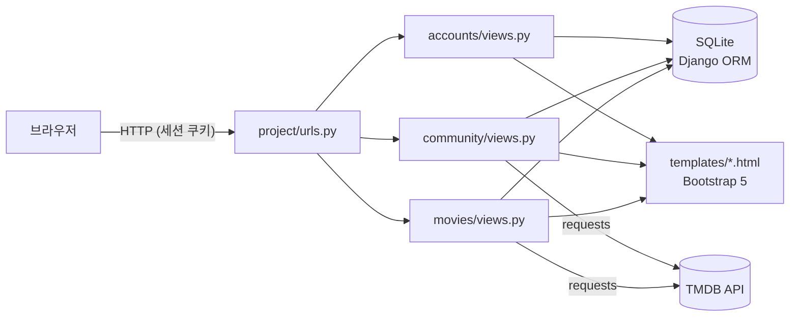
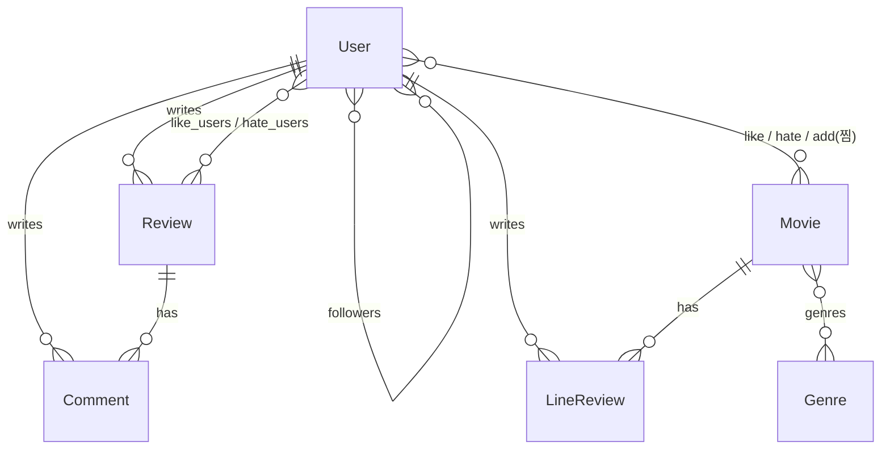
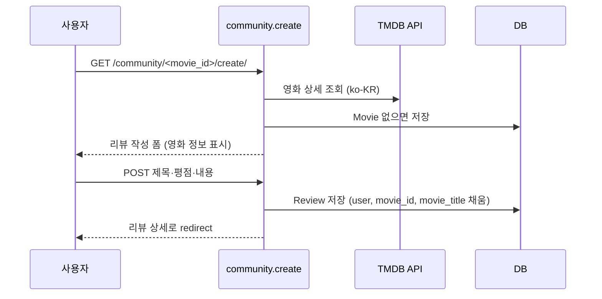

# 📖 MovieStar — 코드 가이드

2021년 SSAFY 1학기 관통 프로젝트(2인) **MovieStar**의 원본 코드를 다시 읽고 정리한 문서입니다.
어떤 구조로 만들었는지, 요청이 어떻게 처리되는지, 그리고 **지금 다시 본다면 무엇을 고칠지**를 함께 적었습니다.

> 담당: **장용원 — `accounts`(회원), `community`(리뷰 커뮤니티)** · 조영우 — `movies`(영화 데이터·추천)

---

## 1. 전체 구조

```
final_pjt(장용원, 조영우)/project/
├── project/          # settings.py, urls.py (앱 라우팅 연결)
├── accounts/         # 회원가입·로그인·로그아웃·비밀번호 변경·탈퇴        ← 담당
├── community/        # 영화 리뷰 게시판, 댓글, 좋아요/싫어요, 검색          ← 담당
├── movies/           # TMDB 영화 데이터 저장, 목록·상세·추천, 한줄평
└── Procfile          # Heroku 배포 설정
```



- **Django MTV**: Model(데이터) → View(처리) → Template(화면). 별도 프론트엔드 없이 서버가 HTML을 렌더링합니다.
- 영화 정보는 **TMDB API**로 받아 오고, 처음 조회될 때 `Movie` 테이블에 저장해 두고 다시 씁니다.
- 좋아요/싫어요만 `JsonResponse`로 응답해, 화면에서 페이지 새로고침 없이(AJAX) 숫자를 바꿉니다.

## 2. 데이터 모델



| 모델 | 앱 | 주요 필드 |
|---|---|---|
| `User` | accounts | `AbstractUser` 확장, `followers`(자기 자신과 다대다, `symmetrical=False`) |
| `Review` | community | `title`, `movie_id`, `movie_title`, `rank`(0~10), `content`, `like_users`, `hate_users`, `click`(조회수) |
| `Comment` | community | `review`(FK), `user`(FK), `content` |
| `Movie` | movies | TMDB 정보(`movie_id`, `popularity`, `vote_average` …), `genres`, 좋아요·싫어요·찜 사용자 |
| `LineReview` | movies | 한줄평 + `rating` |

## 3. 내가 맡은 부분 자세히

### 3-1. accounts — 회원

| URL | View | 동작 |
|---|---|---|
| `signup/` | `signup` | `UserCreationForm`을 확장한 `CustomUserCreationForm`으로 가입 → 바로 로그인(`auth_login`) |
| `login/` | `login` | `AuthenticationForm` 검증 → 로그인 후 `?next=` 주소가 있으면 그곳으로 이동 |
| `logout/` | `logout` | 세션 삭제 후 로그인 페이지로 |
| `password/` | `change_password` | `PasswordChangeForm` 확장(라벨 한글화) → `update_session_auth_hash`로 **비밀번호를 바꿔도 로그인 유지** |
| `delete/` | `delete` | POST로만 탈퇴 |

- 이미 로그인한 사용자가 가입·로그인 페이지에 오면 메인으로 돌려보냅니다.
- `@require_http_methods`, `@require_POST`로 **허용할 HTTP 메서드를 view마다 명시**했습니다.

### 3-2. community — 리뷰 커뮤니티

| URL | View | 동작 |
|---|---|---|
| `''` | `index` | 리뷰 목록. POST로 검색어가 오면 `movie_title__icontains`로 영화 제목 검색 |
| `<movie_id>/create/` | `create` | TMDB에서 영화 상세를 받아 `Movie`에 없으면 저장한 뒤 리뷰 작성 |
| `<review_pk>/` | `detail` | 리뷰 상세 + 댓글 목록, 조회수(`click`) +1 |
| `<review_pk>/update`, `/delete` | `update`, `delete` | 리뷰 수정·삭제 |
| `<review_pk>/comments/` | `create_comment` | 댓글 작성 (`commit=False`로 리뷰·작성자를 채운 뒤 저장) |
| `<review_pk>/like/`, `/hate/` | `like`, `hate` | 이미 눌렀으면 취소, 아니면 추가 → `{liked, count}` JSON 응답 |

**리뷰 작성 흐름**



**좋아요 토글 (AJAX)**
`review.like_users.filter(pk=user.pk).exists()`로 이미 눌렀는지 확인해 `add`/`remove`하고, 화면은 JSON의 `count`만 받아 숫자를 바꿉니다. 비로그인 요청은 `401`.

### 3-3. movies — 팀원 담당 (요약)
- 메인: 조회순·인기순·평가 많은순 6개씩 + **내가 좋아요한 영화들의 장르와 같은 영화 중 6개를 랜덤 추천**
- 상세: TMDB `recommendations` API로 비슷한 영화 12개, 한줄평, 자체 평점 계산
- 장르 페이지: 장르별 인기·평가·최신·언어(한/영/일/중)별 목록

## 4. 지금 다시 본다면 — 코드 리뷰

2021년에는 기능을 완성하는 데 집중했고, 지금 다시 읽으면 고쳐야 할 부분이 보입니다.
면접에서 "프로젝트에서 아쉬운 점"을 물으면 이 내용으로 답할 수 있습니다.

### ① 권한 검사 누락 (가장 중요)
`community.update`, `delete`, `comment_delete`가 **작성자 본인인지 확인하지 않습니다.**
로그인만 하면(일부는 로그인조차 확인하지 않고) URL만 알면 다른 사람의 글을 수정·삭제할 수 있습니다.

```python
# 개선
@login_required
@require_POST
def delete(request, review_pk):
    review = get_object_or_404(Review, pk=review_pk)
    if review.user != request.user:
        return HttpResponseForbidden()
    review.delete()
    return redirect('community:index')
```

### ② 상세 페이지를 볼 때마다 평점이 변하는 문제 (movies)
`movies.detail`이 접속할 때마다 기존 `vote_average`·`vote_count`에 리뷰 점수를 **다시 더해 저장**합니다. 같은 리뷰가 반복해서 반영되어, 새로고침할수록 평점과 참여자 수가 틀어집니다.
또 `new_rating + i.rank`는 `+=`가 아니라서 일반 리뷰 점수는 실제로 더해지지 않습니다.
→ TMDB 원래 값은 그대로 두고, 화면에 보여 줄 평점은 **조회할 때 계산만** 하거나 리뷰가 생길 때만 갱신해야 합니다.

### ③ 조회수 증가
`detail`에서 `review.click += 1; review.save()`는 동시에 여러 명이 보면 값이 덮어써질 수 있습니다.
→ `Review.objects.filter(pk=pk).update(click=F('click') + 1)`로 DB에서 원자적으로 증가.

### ④ 쿼리 수 (N+1)
추천 로직이 좋아요한 영화마다 `Movie.objects.get` → 장르마다 `filter`를 반복해 쿼리가 많이 나갑니다.
→ `Movie.objects.filter(genres__in=liked_genres).exclude(...).distinct()` 한 번으로 가능. 목록에서는 `select_related('user')`.

### ⑤ 외부 API 호출 위치
리뷰 작성·상세 페이지를 열 때마다 TMDB를 동기 호출해 응답이 느려지고, TMDB가 실패하면 페이지도 실패합니다.
→ DB에 있으면 API를 부르지 않기, 타임아웃·예외 처리, 영화 데이터는 관리 명령(`manage.py loaddata`/배치)으로 미리 적재.

### ⑥ 기타
- `Review`·`Comment` 모델에 `user` 필드가 두 번 선언되어 있음(뒤의 것만 적용) → 정리
- `random.sample(set, 6)`은 Python 3.11부터 에러 → `random.sample(list(...), 6)`
- 검색·싫어요·찜 일부 view에 `@login_required` 누락
- API 키는 `python-decouple`로 분리해 둔 점은 잘한 부분, 다만 URL 쿼리스트링에 키가 노출되지 않도록 서버 로그 주의

## 5. 예상 면접 질문

**Q. Django에서 로그인은 어떻게 유지되나요?**
`auth_login`이 세션을 만들고 세션 ID를 쿠키로 내려줍니다. 이후 요청마다 쿠키로 사용자를 찾아 `request.user`에 넣어 줍니다. 비밀번호를 바꾸면 세션이 무효화되기 때문에 `update_session_auth_hash`로 세션을 갱신했습니다.

**Q. `commit=False`는 왜 썼나요?**
폼에는 제목·내용만 있고 작성자와 영화 정보는 서버에서 채워야 하기 때문에, 저장 전에 객체만 만든 뒤 필드를 채우고 `save()`했습니다.

**Q. 좋아요를 AJAX로 만든 이유는?**
좋아요 하나 때문에 페이지 전체를 다시 그리지 않도록, 서버는 JSON으로 상태와 개수만 주고 화면은 그 숫자만 바꿉니다.

**Q. 다시 만든다면 가장 먼저 고칠 것은?**
작성자 권한 검사입니다. 화면에서 수정 버튼을 숨기는 것만으로는 URL 직접 호출을 막을 수 없어서, view에서 `review.user == request.user`를 반드시 확인해야 합니다.
