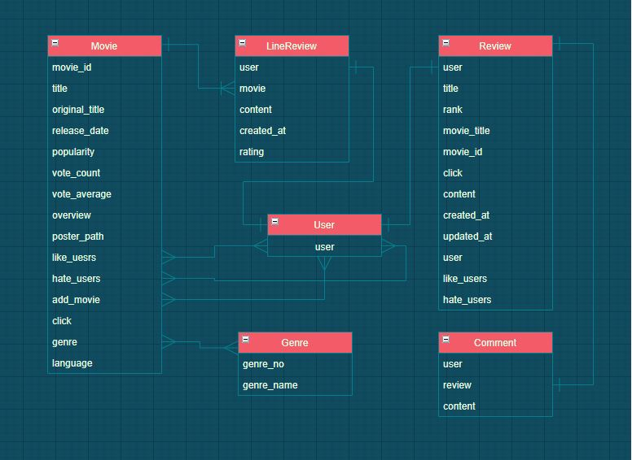

# FINAL_PJT(2021.05.20. ~ 05.28)

## 관통 프로젝트

#### 1. 목표

- 영화 정보 기반 추천 서비스 구성
- 커뮤니티 서비스 구성
- HTML, CSS, JavaScript, Vue.js, Django, REST API, DataBase 등을 활용한 실제 서비 스 설계
- 서비스 관리 및 유지보수요구사항


#### 2. 팀원 정보 및 업무 분담 내역

- 구미 1반 장용원
  - community (front, back)
- 구미 1반 조영우
  - movies (front, back) 


#### 3. 목표 서비스 구현 및 실제 구현 정도

- 목표 서비스 
  - API를 활용하여 얻은 영화 정보를 활용해 인기순, 평점순으로 영화 데이터 출력
  - 사용자가 누른 '좋아요'에 기반한 영화 추천
- 실제 구현 : 

#### 4. 데이터베이스 모델링(ERD)



#### 5. 필수 기능에 대한 설명


#### 6. 배포 서버 URL


#### 7. 기타(느낀점)


## 결과


## Code

### 1. App.vue

```vue
<template>
  <div id="app">
    <div id="nav">
      <router-link :to="{ name: 'Home' }">Home</router-link> |
      <router-link :to="{ name: 'Random' }">Random</router-link> |
      <router-link :to="{ name: 'MyMovieList' }">MyMovieList</router-link>
    </div>
  <router-view/>
  </div>
</template>

<script>

export default {
  name: 'App',
  components: {
    
  }
}
</script>

<style>
#app {
  font-family: Avenir, Helvetica, Arial, sans-serif;
  -webkit-font-smoothing: antialiased;
  -moz-osx-font-smoothing: grayscale;
  text-align: center;
  color: #2c3e50;
  margin-top: 60px;
}

#nav {
  padding: 30px;
}

#nav a {
  font-weight: bold;
  color: #2c3e50;
}

#nav a.router-link-exact-active {
  color: #42b983;
}
</style>

```


### 2. Home.vue

```vue
<template>
  <div>
    <h1>Home</h1>
    <MovieCard v-for="(movieItem, idx) in movieItems"
      :key="idx"
      :movieItem="movieItem" />
  </div>
</template>

<script>
import MovieCard from '@/components/MovieCard'

const MOVIE_URL= 'https://gist.githubusercontent.com/eduChange-hphk/d9acb9fcfaa6ece53c9e8bcddd64131b/raw/9c8bc58a99e2ea77d42abd41376e5e1becabea69/movies.json'

import axios from 'axios'

export default {
  name: 'Home',
  data: function () {
    return {
      movieItems: ''
    }
  },
  created: function () {
    axios.get(MOVIE_URL)
      .then (response => {
        console.log(response.data)
        this.movieItems = response.data
    })
  },
  components: {
    MovieCard,
    },
}
</script>

```


### 3. MyMovieList.vue

```html
<template>
  <div>
    <h1>MyMovieList</h1>
    <MyListForm @send-movie="getMovie"/>
    <MyList v-for="(myMovie, idx) in myMovies"
    :key="idx"
    :myMovie="myMovie"/>

  </div>
</template>

<script>
import MyList from '@/components/MyList'
import MyListForm from '@/components/MyListForm'

export default {
  name: 'MyMovieList',
  data: function () {
    return {
      myMovies : [],
    }
  },
  components: {
    MyList,
    MyListForm,
  },
  methods: {
    getMovie: function (data) {
      this.myMovies.push(data)
    }
  }
}
</script>

<style>

</style>
```


### 4. Random.vue

```vue
<template>
  <div class="Random">
    <h1>Random</h1>
    <button @click="pickMovie">Pick</button>
    <p>{{ randomList.title }}</p>
    <p></p>
  </div>
</template>


<script>
import _ from 'lodash'

const MOVIE_URL= 'https://gist.githubusercontent.com/eduChange-hphk/d9acb9fcfaa6ece53c9e8bcddd64131b/raw/9c8bc58a99e2ea77d42abd41376e5e1becabea69/movies.json'

import axios from 'axios'

export default {
  name: 'Random',
  data: function () {
    return {
      randomList: []
    }
  },
  // methods: {
  //   pickMovie: function () {
  //     this.randomList = _.sample(this)
  //   },
  // },
  methods: {
    pickMovie: function () {
    axios.get(MOVIE_URL)
      .then (response => {
        this.randomList = _.sample(response.data)
    })
  }
  },
  components: {
    },
}
</script>
```

### 5. MovieCard.vue

```vue
<template>
  <div>
    
    <h2>{{ movieItem.title }}</h2>
    <h2>{{ movieItem.overview }}</h2>

  </div>
</template>

<script>
export default {
  name: 'MovieCard',
  props: {
    movieItem: Object
  },
  computed: {
    moviePoster: function () {
      return `https://image.tmdb.org/t/p/w500/${ this.movieItem.poster_path }`
    },
  }
}
</script>

<style>

</style>
```

### 6. MyList.vue

```vue
<template>
  <div>
    <ul>
      <li>{{ myMovie }}</li>
    </ul>
  </div>
</template>

<script>
export default {
  name: 'MyList',
  props: {
    myMovie : String,
  }
}
</script>

<style>

</style>
```

### 7. MyListForm.vue

```vue
<template>
  <div>
    <p>MylistForm</p>
    <input type="text" @keydown.enter="addMyList" v-model="inputMovie">
    <button @click="addMyList">add</button>
  </div>
</template>

<script>
export default {
  name: 'MyListForm',
  data: function () {
    return {
      inputMovie: ''
    }
  },
  methods: {
    addMyList : function () {
      this.$emit('send-movie', this.inputMovie)
      this.inputMovie = ''
    }
  }
}
</script>

<style>

</style>
```


## 소감 및 어려웠던 점

Vue를 짧은 시간 동안 생각보다 많은 내용을 배우다 보니 프로젝트를 하기 전 머릿속에 잘 정리가 되어있지 않았던 것 같다. router를 사용하는법, props and emit 등 을 그래도 열심히 공부했었기 때문에 잘 활용할 수 있을 것이라고 생각했는데,  복합적으로 사용하여 페이지를 만드는 것은 생각보다 쉽지 않았다.

특히 Home.vue에서 URL 정보를 받아 MovieCard.vue 에 넘겨주는 것이 가장 잘 해결되지 않아 많은 시간을 소비하였습니다.  Life Cycle에 대한 이해도가 부족했던 것 같습니다.

이번 프로젝트를 진행하면서 전체적인 Vue의 흐름에 대해 이해할 수 있었습니다. 시간이 부족해 홈페이지를 꾸미는 작업은 못해서 아쉬움이 남습니다.


